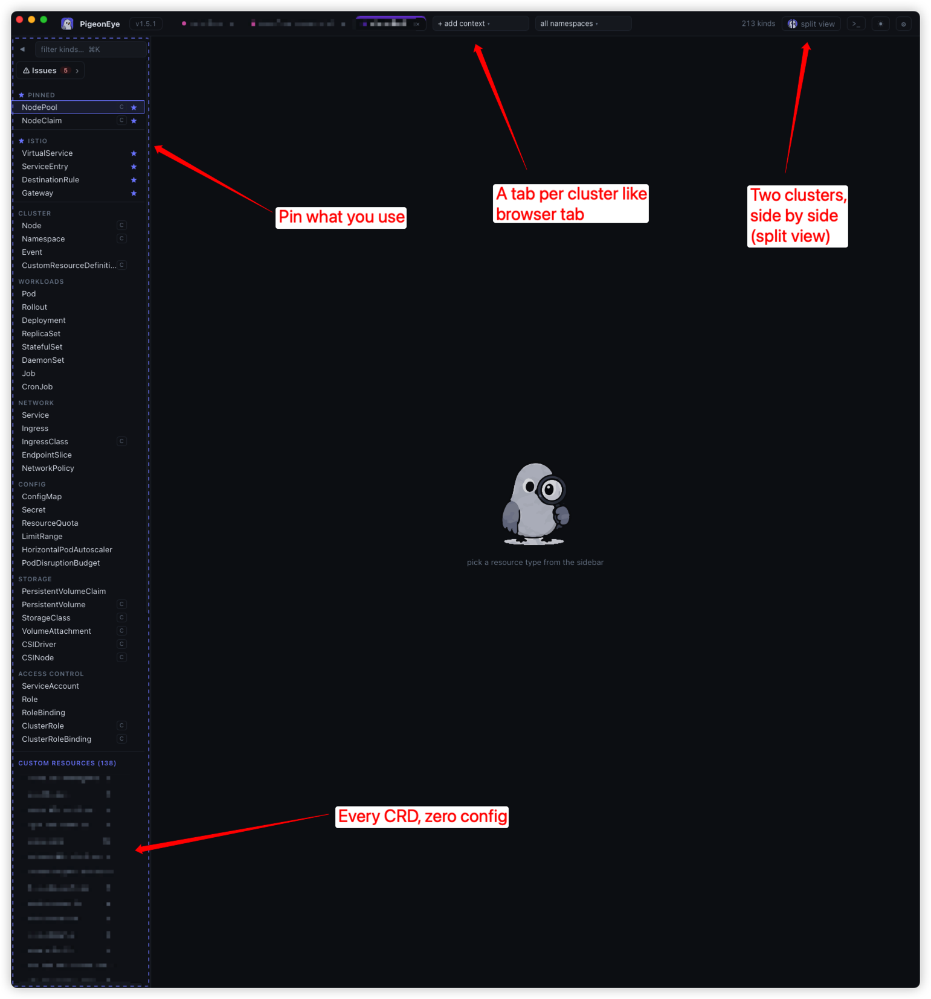
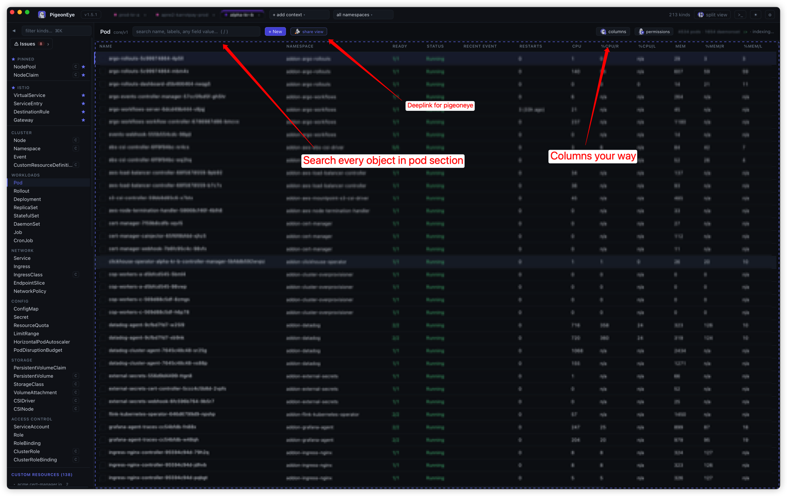
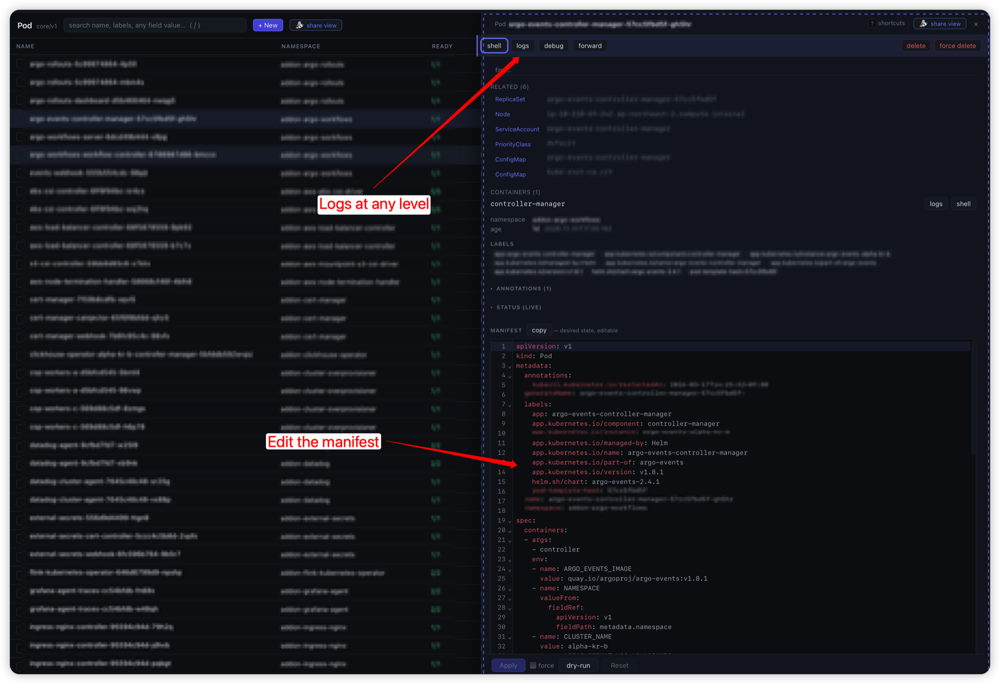

<p align="center">
  
</p>

<p align="center"><b>A bird's-eye view of your clusters. Faster than anything.</b></p>

<p align="center">
  
</p>

<p align="center"><a href="README.md">English</a> | 한국어</p>

PigeonEye는 CLI처럼 다루는 빠른 네이티브 Kubernetes GUI입니다. 클러스터가
서빙하는 모든 리소스 타입 — 모든 CRD 포함 — 이 자동으로 표시되고,
`kubectl get`과 동일한 칼럼을 보여줍니다.

## 한눈에 보기



**클러스터가 서빙하는 모든 리소스를 사이드바 하나에.** 기본 kind는 익숙한
분류대로 묶여 있고, CRD는 따로 등록하지 않아도 자동으로 따라붙습니다 — 이
화면에서는 138개. 자주 쓰는 kind는 `p`로 핀해서 나만의 그룹으로 모읍니다.
클러스터마다 브라우저처럼 탭이 하나씩 생기고, `⌘\`로 창을 나누면 두
클러스터를 나란히 봅니다.



**빠르게 찾고, 원하는 대로 보는 목록.** 검색은 이름만이 아니라 모든
오브젝트의 모든 필드를 뒤집니다. 컬럼은 보이기·숨기기·순서 변경·추가가
자유롭고, requests·limits 대비 CPU·메모리도 컬럼으로 볼 수 있습니다.
**share view**는 같은 클러스터·kind·네임스페이스·행을 여는 `peye://`
링크를 복사합니다.



**오브젝트 하나의 모든 것을, 목록을 떠나지 않고.** 로그·셸·디버그
컨테이너·포트포워드가 클릭 한 번이고, `l` 하나로 Deployment 전체, 파드
하나, 컨테이너 하나의 로그를 봅니다. 관련 리소스로 바로 넘어갈 수 있고,
매니페스트는 그 자리에서 고칩니다 — **dry-run**으로 서버가 무엇을 바꿀지
먼저 보고 **Apply**합니다.

## CLI처럼 다루는 GUI

화면은 GUI, 손은 CLI. 원할 땐 클릭하면 되지만, 매일 하는 일에는 전부 키가
있습니다 — 이동, 검색, 로그·셸 열기, 편집, 스케일, 삭제, 클러스터 전환,
화면 분할까지. 키는 vim, k9s, `kubectl`에서 이미 손에 익은 그대로입니다.

| 키 | 동작 |
|---|---|
| `:` | 입력해서 어디로든 이동 — `: deploy kube-system`, `: pod app=api`, `: pod @prod` |
| `/` | 모든 행의 모든 필드 검색 |
| `j` `k` · `↵` | 이동 · 상세 열기 |
| `l` · `s` · `e` | 로그 · 셸 · 매니페스트 편집 |
| `d` · `r` · `space` | 삭제 · 롤아웃 재시작 · 여러 행 선택해 일괄 작업 |
| `tab` · `⌘\` | 다음 클러스터 · 두 화면으로 분할 |
| `?` | 전체 단축키를 한 장으로 |

## 왜 빠른가

프로덕션 클러스터(**파드 23,770개 · 이벤트 171,267개**)에서 실측:

| | PigeonEye | 전체 오브젝트 LIST (informer 클라이언트가 연결 시 하는 일) |
|---|---|---|
| 파드 첫 화면 | **~0.35초 / 350 KB** | 60초+ 동안 136 MB 받고도 미완 |
| 연결 시 Discovery | **0.18초**, 단일 요청 | API 그룹마다 왕복 1회 |

테이블은 화면에 보이는 행만 렌더(가상 스크롤)하므로, 2만 4천 행 목록을
필터링해도 **키 입력당 ~0.5ms**입니다. 열린 목록은 watch로 **실시간**
갱신되고, 다시 방문하면 **캐시된 resourceVersion부터 watch를 재개**해 그
사이 변경분만 받습니다(전체 재조회 없음).

떠 있는 동안의 비용도 쌉니다. 그 2만 4천 행 목록에서 파드 하나가 바뀌어
반영되는 데 **~0.2ms**입니다. 목록 전체를 다시 색인하지 않고 이벤트가 지목한
행만 대조하며, 롤아웃이 한 번에 몇백 개를 내리더라도 한 번의 패스로 빠집니다.

**속도의 비결:** 서버사이드 프린터 컬럼(Table API — 뷰당 요청 1회, 전체
오브젝트 동기화 없음), 스트리밍 페이징, 가상 스크롤, 지연 구축 전문 인덱스,
watch 증분 갱신(배치 병합), 재방문 시 watch 재개 캐시.

## 주요 기능

- **모든 리소스, 설정 0.** kind는 Discovery API에서 오므로 **모든 CRD가
  자동 표시**되고, `kubectl get`과 동일한 컬럼을 씁니다.
- **컬럼을 내 맘대로.** 숨김·드래그 재정렬, **아무 필드/라벨이나 커스텀
  컬럼으로 추가**(`kubectl -o custom-columns`을 타이핑 대신 클릭으로).
  자주 쓰는 kind는 **내 그룹으로 핀**. 클러스터도 이름 붙인 컨텍스트
  그룹으로 정리할 수 있습니다.
- **제대로 찾는 검색.** 모든 필드 전문 검색 + 정규식·`!`제외, 컬럼별 값
  필터, 숫자 부등호 비교(`> 500`).
- **열린 클러스터 전체를 한 번에 검색.** `: pod api-server` 하나로 모든
  클러스터에 묻고, 각 결과가 **어느 클러스터에서 왔는지** 표시합니다.
  고르면 탭·kind·네임스페이스가 따라가고 커서가 그 행에 놓입니다. 묻기
  전까지는 비용이 0이고, 이미 둘러본 클러스터는 메모리에서 즉시 답합니다.
- **두 개의 독립된 화면으로 분할.** `⌘\`로 완전히 독립적인 두 패널을 나란히
  띄웁니다. 서로 다른 클러스터·kind·네임스페이스를 각자의 watch·검색·정렬·
  상세 패널과 함께 봅니다. `⌘←` / `⌘→`로 포커스를 옮기고, 모든 단축키는
  포커스된 패널에 적용됩니다.
- **클러스터 전체의 문제를 한 목록으로.** 상태가 나쁜 파드와 Ready가 아닌
  노드를 **연결된 모든 클러스터**에서 모아 ⚠ 목록으로 보여주고, 백그라운드에서
  계속 갱신합니다. `↵`로 해당 리소스의 탭으로 바로 이동합니다. 목록은 가상
  스크롤이라 문제가 4,000개든 4개든 똑같이 빨리 열립니다 — 이 목록이 가장
  길어지는 때가 하필 장애 중이라 중요한 부분입니다.
- **롤아웃을 한눈에.** Deployment·StatefulSet·DaemonSet·ReplicaSet과 Argo
  **Rollout**은 레플리카가 아직 퍼지는 중이면 점이 붙어서, 덜 끝난 롤아웃을
  열어보지 않고도 알 수 있습니다. 열어보면 지금 어디쯤인지 — *Rolling out*,
  *Applying*(스펙은 바뀌었는데 컨트롤러가 아직 반영 전), *Not fully
  available*, *Paused*, *Stuck*, *Synced* — 레플리카·generation 숫자와 함께
  보여주고, 끝날 때까지 스스로 갱신합니다.
- **파드가 왜 안 뜨는지, 목록에서 바로.** 상태 컬럼이 *Pending*이면 옆의
  **Recent event** 컬럼이 `FailedScheduling ×3 · 45s`라고 알려주고,
  마우스를 올리면 `0/50 nodes are available: insufficient cpu`가 보입니다.
  경고만 표시하므로 빈 칸은 문제없다는 뜻입니다. 5분이 지난 경고는 지우지
  않고 흐리게 남깁니다 — 지금은 괜찮은 파드라도 그 경고가 재시작한
  이유인 경우가 많기 때문입니다.
- **보고 있는 화면을 그대로 공유.** 현재 뷰나 특정 리소스로 가는 `peye://`
  링크를 복사합니다. 받은 사람은 같은 클러스터·kind·네임스페이스·행에서
  시작합니다.
- **진짜 로그 뷰어.** follow, 크래시용 previous, since 윈도, 타임스탬프,
  인-뷰 검색·복사·다운로드, 워크로드 통합 로그.
- **셸·디버깅.** 파드 exec, 투명한 privileged **노드 셸**, 파드의
  securityContext를 따라가는 **ephemeral 디버그 컨테이너**(restricted
  PodSecurity / Kyverno 통과).
- **안전한 편집·운영.** YAML **서버사이드 apply**(dry-run), 템플릿 생성,
  스케일, 롤아웃 restart/history/undo, drain, CronJob trigger, Secret
  reveal, **포트포워드** 관리, **`top`** 메트릭, **`auth can-i`**.
- **물어볼 수 있는 로그인.** 토큰이 만료되면 **앱 안의 터미널에서**
  재로그인합니다(AWS SSO·gcloud·Teleport·Azure·OIDC). OTP나 비밀번호를
  묻는 CLI도 답할 곳이 생깁니다. kubeconfig의 `exec`는 명령이 하나뿐이고
  "이거 먼저" 훅이 없으므로, 컨텍스트마다 **사전 명령**을 따로 둘 수도
  있습니다 — `tsh login`, bastion 터널, VPN 같은 것들을 연결 전에
  실행하고, 공용 kubeconfig가 아니라 **내 머신에만** 저장됩니다. 자격증명이
  실제로 만료된 클러스터는 다시 로그인할 때까지 백그라운드 폴링에서 빠집니다 —
  `aws-vault`·`oidc-login`처럼 브라우저를 여는 헬퍼가 타이머에 걸려 반복
  실행되는 일이 없도록.
- 색으로 구분되는 멀티 클러스터 탭, 라이트/다크, 새 릴리즈를 상단바에
  알리고 **앱 안에서 바로 업데이트**(brew 불필요).

## k9s · Lens 비교

|  | PigeonEye | k9s | Lens/OpenLens |
|---|---|---|---|
| 네이티브 GUI | ✅ | 터미널 | Electron |
| 일상 작업 전부 키보드로 | ✅ | ✅ | 마우스 위주 |
| 2.4만 파드 초기 로딩 | **~0.35초 첫 화면** | 빠름 | 느림(전체 동기화) |
| 모든 CRD/집계 API, 무설정 | ✅ | ✅ | ✅ |
| 정규식/제외/숫자/컬럼별 필터 | ✅ | 정규식/`!` | 기본 |
| 로그 previous·since·검색·다운로드 | ✅ | ✅ | ✅(Lens만) |
| 워크로드/Service 통합 로그 | ✅ | ✅ | 일부 |
| ephemeral **디버그** 컨테이너(정책 안전) | ✅ | — | — |
| **노드 셸**(nsenter) | ✅ | 옵션 | ✅ |
| Secret 디코드 | ✅ | ✅ | ✅ |
| 적용 전 서버 **dry-run** | ✅ | — | — |
| 템플릿 생성 | ✅ | 빈 YAML | ✅ |
| 롤아웃 history/undo | ✅ | ✅ | ✅ |
| CronJob trigger/suspend | ✅ | ✅ | — |
| 노드·파드 **메트릭 컬럼** | ✅ | ✅ | Prometheus 필요 |
| `auth can-i` / 권한 | ✅ | 역조회 | RBAC 뷰 |
| 열린 클러스터 전체 이름 검색 | ✅ | — | — |
| 독립된 두 패널 분할 화면 | ✅ | — | — |
| 모든 클러스터의 문제 리소스를 한 목록으로 | ✅ | — | — |
| 특정 뷰·리소스로 가는 딥링크 | ✅ | — | — |
| 인증 재로그인 — OTP 등을 묻는 CLI 포함 | ✅ | — | — |
| 컨텍스트별 사전 명령(터널 / `tsh login`) | ✅ | — | — |
| 시계열 메트릭 차트 | — | — | ✅(Prometheus) |
| Helm/확장/xray 트리/린터 | — | xray/popeye/plugins | Helm/확장 |

메트릭 그래프, Helm, owner **xray 트리**, 클러스터 린터가 아직 없는 주요
항목입니다. owner↔children 탐색은 관련 리소스 점프로 한 번에 됩니다.

## 지원 플랫폼
| 플랫폼 | 상태 |
|---|---|
| macOS (Apple Silicon / Intel) | ✅ 지원 |
| Linux (x86_64) | ✅ 지원 |
| Windows (x86_64) | ✅ 지원 |

## 설치

**macOS — Homebrew**

```sh
brew tap tackish/pigeoneye
brew trust tackish/pigeoneye   # 서드파티 tap은 최초 1회 신뢰 등록 필요
brew install --cask peye
```

설치 후에는 Spotlight로 실행하거나, 터미널에서 `peye`만 치면 앱이 열립니다:

```sh
peye
```

**Windows** — [Releases](https://github.com/tackish/pigeoneye/releases)에서
`-setup.exe`를 받아 설치합니다(정책 배포용 `.msi`도 함께 올라갑니다).
아직 코드 서명이 없어서 SmartScreen이 막습니다 — **추가 정보 → 실행**으로
넘어가면 됩니다.

**Linux** — [Releases](https://github.com/tackish/pigeoneye/releases)에서
`.deb` / `.rpm` / `.AppImage`를 받아 설치합니다.

**소스 빌드** (Rust stable + Node 20+):

```sh
npm install
npm run tauri build   # 설치 파일: src-tauri/target/release/bundle/
npm run tauri dev     # 바로 실행
```

## 시작하기

1. **실행하면 끝.** 기본 kubeconfig 체인(`$KUBECONFIG`, 없으면
   `~/.kube/config`)을 자동으로 읽습니다. 별도 설정이 필요 없습니다.
2. 상단의 **“+ add context”** 드롭다운으로 클러스터에 연결합니다. 각
   클러스터는 **탭**으로 열리며 원하는 만큼 여러 개를 열 수 있고, 서로 다른
   클러스터 요청은 병렬로 처리됩니다. 탭 구성과 마지막 활성 클러스터는
   재시작 시 자동 복원됩니다.
3. **kubeconfig 파일이 더 있다면** **⚙ 설정**에서 경로를 추가하세요
   (예: `~/.kube/staging-config`). 모든 파일의 컨텍스트가 병합되어
   나열되고, 각 컨텍스트는 자신의 소스 파일을 기억합니다.
4. **먼저 뭔가 해야 붙는 클러스터라면?** 로그인이나 터널이 선행돼야
   닿는 클러스터가 있는데, kubeconfig로는 표현할 수 없습니다. 컨텍스트
   목록에서 **⋯** 를 눌러 명령을 넣어두면 연결 **전에** 터미널에서
   실행되므로, 무엇을 묻든 그 자리에서 답할 수 있습니다:

   ```
   tsh status >/dev/null 2>&1 || tsh login --proxy=teleport.example.com:443
   ```

5. **bastion이나 사내 프록시 뒤에 있는 클러스터라면?** 클러스터의
   `proxy-url:`(SOCKS5 또는 HTTP `CONNECT`)과 `HTTPS_PROXY`를 따르므로,
   점프 호스트를 거쳐야만 닿는 클러스터도 다른 클러스터처럼 연결됩니다.
   `kubectl`과 같은 줄을 읽기 때문에 둘이 어긋날 일이 없고, 클러스터
   단위라서 나머지는 그대로 직접 나갑니다.

   ```yaml
   - cluster:
       server: https://XXXX.gr7.ap-northeast-2.eks.amazonaws.com
       proxy-url: socks5://127.0.0.1:1080   # 예: `ssh -D 1080` bastion
   ```

   이름 해석은 프록시가 하므로, 노트북에서 DNS가 풀리지 않는 프라이빗
   엔드포인트도 그대로 연결됩니다.

## 라이선스

[PolyForm Noncommercial 1.0.0](LICENSE) — 개인 및 비영리 목적 사용은
자유입니다. **상업적 사용은 허용되지 않습니다.**
